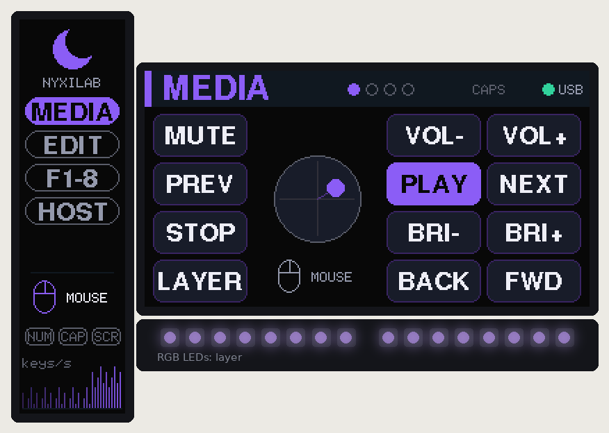
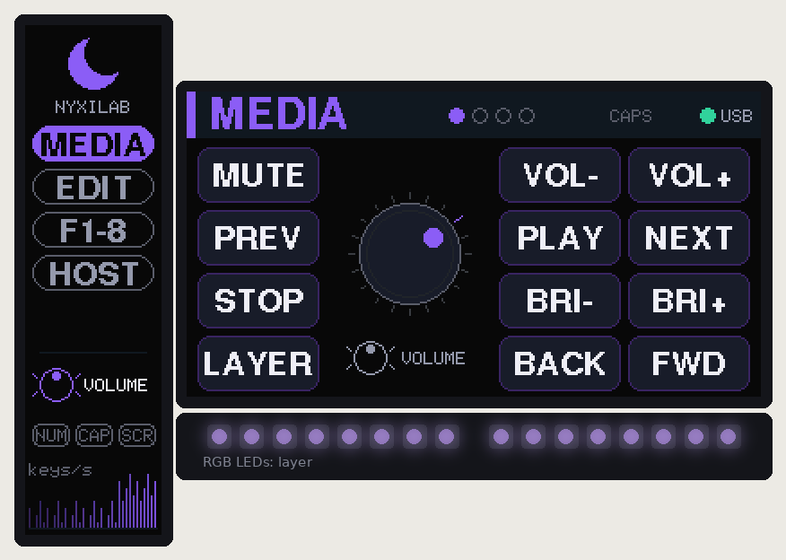

# Firmware

The firmware of both editions is one code base: four PlatformIO libraries here in
`lib/`, and one small project per edition that adds its centre control and keymap
([`joystick/firmware`](../../joystick/firmware), [`rotary/firmware`](../../rotary/firmware)).
It runs on the Raspberry Pi Pico 2 (RP2350) and the Pico (RP2040), on the
[Arduino-Pico](https://github.com/earlephilhower/arduino-pico) core with Adafruit
TinyUSB (composite HID), Adafruit GFX / ST7789 and Adafruit NeoPixel.

| Joystick edition | Rotary edition |
|---|---|
|  |  |

<sub>Rendered by `tools/ui_sim` from the real firmware code, with the 16 LEDs as the firmware
would light them.</sub>

## Build & flash

| Project | Environment | Board | UF2 |
|---|---|---|---|
| `joystick/firmware` | `pico2` (default) / `pico` | Pico 2 / Pico | `joystick/firmware/dist/nyxilab-macropad-joystick-pico2.uf2` (`-pico.uf2`) |
| `rotary/firmware` | `pico2` (default) / `pico` | Pico 2 / Pico | `rotary/firmware/dist/nyxilab-macropad-rotary-pico2.uf2` (`-pico.uf2`) |

```bash
cd joystick/firmware        # or rotary/firmware
pio run                     # Pico 2
pio run -e pico             # original Pico
pio run -t upload           # flash over USB (reboots the pad into the bootloader itself)
pio device monitor          # serial console, 115200
pio test -e native          # this edition's unit tests on the PC
```

From the repo root: `make firmware` (both editions, Pico 2), `make firmware-all` (all
four UF2 files), `make test` (all unit tests), `make ui-sim` (render the UI).
`make test-hardware` runs USB, settings and centre-control regressions with mocked
hardware; it needs Python 3 and g++, without PlatformIO or board dependencies.

First flash, or if the firmware is broken: hold **BOOTSEL** while plugging the Pico
in and copy the UF2 for your board and edition to the `RP2350` (or `RPI-RP2`) drive.
Once the case is closed you do not need BOOTSEL any more:
- `pio run -t upload` resets the pad into the bootloader over USB,
- or hold the **back-left + front-right** keys while plugging in,
- or press **FN + BOOT** (hold the front-left key, press the back-left key).

## Features

- 4×3 hand-wired matrix, COL2ROW, 1 kHz scan, 5 ms per-key debounce
- Composite USB HID: 6-key keyboard + consumer (media) + mouse with wheel and pan
- Layers with momentary / toggle / to / next, tap-hold keys (hold-on-other-key), text macros
- **Joystick edition**: mouse, scroll or arrow keys, chosen per layer and cycled with
  FN + JOY; stick click = left click / middle click / Enter; radial dead zone, response
  curve, auto-learned travel
- **Rotary edition**: every layer says what the knob does (turn clockwise, turn
  counter-clockwise, press). FN + KNOB switches the current layer to a preset (volume,
  scroll, zoom, arrows) and back; the displays name the pick for 1.5 s, because FN's own
  binding is in effect while LAYER is held. The knob is read by pin-change interrupts with a
  detent-synchronised decoder, so bounce never adds steps; key taps from fast turns are
  queued with a 16-detent backlog. Taps and macros wait for USB delivery (with no
  host they play out and are dropped), and taps for a running macro; keys and stick
  arrows held while a macro types are sent when it ends; detents beyond the backlog,
  or still queued when a macro starts, are dropped. Physical key/button
  transitions have a separate
  64-state USB queue; if that fills, intermediate states can be dropped, but the
  latest held/released state is sent once space becomes available. A newly
  mounted host gets only what is held at that moment.
- **RGB LED sticks** (2 × 8 WS2812B, both editions): layer colour with a flash on every key
  press or knob click, breathing, or a rainbow running around the case; FN + LED cycles
  the modes. On the CONFIG layer, LEDCOL picks the colour for the layer and breathing
  modes (LAYER = the layer's colour, WHITE, RED, GREEN, BLUE, PURPLE, CYAN, AMBER; the
  rainbow ignores it) and LED− / LED+ set the level, 1 to 8. The brightness never goes
  above 35 % (`LED_MAX_BRIGHTNESS` = 89 of 255); level k caps it at 89 × k / 8. At power-up a green run fills the chain, blinks twice and goes dark, then the
  chosen effect starts (1.6 s; not in Off mode). They follow the display brightness and idle dimming and go dark while the host
  sleeps; a 250 mA current budget keeps the pad inside a USB 2.0 port's limit.
- Main display (1.9"): layer name, the 12 key labels in their physical layout with live
  press highlight, the joystick position and mode or a knob dial with its current
  function, CAPS and USB state
- Bar display (2.25"): layer list, joystick mode or knob function, NUM/CAPS/SCROLL LEDs
  from the host, key-press activity graph
- **Themes**, one per display (CONFIG: MAIN and BAR): NYX (the default), MIDNIGHT, FOREST,
  AMBER, MONO and LIGHT. A theme sets the background, panel, cell and text greys; the
  accent stays the layer's colour. On LIGHT, accent and status colours drawn as text are
  darkened so every page stays readable (`ui/theme.h`).
- **Host bridge** (optional): with the `nyxd` daemon on a Linux computer, the HOST layer
  has three pages: SYS (CPU total, per core and temperature, memory, swap, disk, network,
  GPU, clock), SWAY (sway's workspaces and focused window) and PLAY (the MPRIS media
  player, through `playerctl`). The bar display shows the system info, your own text and
  a LAYER-key legend on every page. `HOST(n)` keys run commands, switch workspaces or
  control the player. Without the daemon the HOST layer stays out of the LAYER cycle. See [the host bridge](../../docs/host-bridge.md).
- Backlight PWM with FN + DIM±, dims after 1 min idle, off after 10 min or when the host sleeps
- Settings (brightness, per-layer stick mode or knob preset, knob direction, LED mode,
  LED colour and level, both display themes, last layer, joystick calibration) stored in flash
  (learned joystick travel is saved after changes settle for about 3 s). Changing
  editions resets centre settings while retaining shared settings. Upgrading from
  settings version 7 (before the CONFIG layer) resets all settings once.
- Dual core: input + USB on core 0; the displays and the LEDs on core 1 (off-screen
  canvases, no flicker). Up to 60 frames a second, the panels' own refresh rate; only the
  16 × 8 tiles of a frame that changed are sent over SPI

## Default keymap

Rows are listed back (row 0) to front (row 3); column 0 is the single column next to the bar display.

| Layer | Col 0 | Col 1 | Col 2 | Joystick | Knob: turn right / left / press |
|---|---|---|---|---|---|
| **MEDIA** | MUTE / PREV / STOP / LAYER | VOL− / PLAY / BRI− / BACK | VOL+ / NEXT / BRI+ / FWD | mouse | volume up / down / mute |
| **EDIT** | UNDO / CUT / FIND / LAYER | REDO / COPY / HOME / ENTER | SAVE / PASTE / END / BKSP | arrows | redo / undo / save |
| **F1-8**, **F9-16**, **F17-24** (one layer, three pages) | FIRST / PREV / NEXT / LAYER | F1 / F3 / F5 / F7 (page 1) | F2 / F4 / F6 / F8 (page 1) | scroll | scroll down / up / middle click |
| **HOST** (with `nyxd`), page SYS | PLAY / SWAY / SYS / LAYER | H7 / H5 / H3 / H1 | H8 / H6 / H4 / H2 | mouse | volume up / down / mute |
| **SWAY** (page 2 of HOST) | PLAY / SWAY / SYS / LAYER | 7 / 5 / 3 / 1 (workspaces) | 8 / 6 / 4 / 2 | mouse | volume up / down / mute |
| **PLAYER** (page 3 of HOST) | PLAY / SWAY / SYS / LAYER | VOL− / −10s / PREV / PLAY | VOL+ / +10s / STOP / NEXT | mouse | volume up / down / mute |
| **CONFIG** (FN + CFG) | BACK / RESET / SCRN / LAYER | MAIN / LEDCOL / LED− / DIM− | BAR / LEDFX / LED+ / DIM+ | mouse | screen brightness + / − / screens on-off |
| **FN** (hold LAYER) | BOOT / JOY or KNOB / MEDIA / (held) | DIM− / CAL or REV / EDIT / CFG | DIM+ / SCRN / FKEYS / LED | – | screen brightness + / − / screens on-off |

LAYER (front-left key): **tap** = next layer, **hold** = FN. Holding LAYER and turning the
knob uses the FN binding straight away.

The F-keys layer has F1–F24 on three pages of eight, on the right block row by row from
the back. NEXT and PREV step through the pages (wrapping around), FIRST goes back to
F1–8, and LAYER moves on to the next layer from any page. F13–F24 are handy for binding
actions in OBS, IDEs and window managers without clashing with real shortcuts. A page is a
layer with a fifth and sixth field, `View::Keys, L_F1`: the layer it belongs to (see
`page_of` in `keymap.h`).

The HOST layer's pages work the same way: SYS, SWAY and PLAY (left column) jump to a
page, and LAYER moves on from any of them. H1–H8 are `HOST(1)`–`HOST(8)`, the SWAY
page's keys are `HOST(201)`–`HOST(208)` and the PLAYER page's `HOST(211)`–`HOST(218)`;
see [the host bridge](../../docs/host-bridge.md) for what the daemon does with them.

CONFIG sets the looks. MAIN and BAR step through the themes of the main and the bar
display, LEDCOL the LED colour, LEDFX the LED mode, LED− / LED+ the LED level and DIM− /
DIM+ the screen brightness; SCRN turns the screens off. RESET puts both themes, the LED
colour and the LED level back to their defaults (brightness and LED mode stay). Each
change is saved. Under each label the main display shows the current value: the theme
name, the colour name with a swatch, the level as k/8, the brightness in %, the LED mode.
Like FN, CONFIG is outside the LAYER cycle and the displays do not list it (`off_cycle`
in `keymap.h`): BACK returns to MEDIA and LAYER moves on to the next layer (MEDIA). The
bar display shows a CONFIG banner. The HELLO macro is still defined but no key types it.

The two centre-control keys on the FN layer differ per edition: **JOY** (cycle the
stick mode) and **CAL** (re-centre) in the joystick keymap, **KNOB** (cycle the knob
preset for this layer) and **REV** (flip the turning direction) in the rotary keymap.

## Customising

| What | Where |
|---|---|
| Keys, labels, layers, colours, tap-hold, macros, stick modes or knob bindings and presets | `<edition>/firmware/src/keymap.cpp` |
| Pins, display rotation / inversion / BGR, stick or knob direction, LED count and brightness, SPI speed, idle times | `<edition>/firmware/include/config.h` |
| Joystick feel (dead zone, curve, speeds, arrow thresholds) | `JoyConfig` in `joystick/firmware/src/joystick.h` |
| LED effects (flash length, breathing and rainbow speed), LED colours, the level rule | `lib/nyx_core/src/core/led_fx.h` |
| Display theme colours | `lib/nyx_ui/src/ui/theme.h` (names in `lib/nyx_core/src/core/themes.h`) |
| Boot-to-bootloader key combo | `BOOT_COMBO` in `lib/nyx_core/src/core/keymap.h` |

Action helpers for the keymap (`lib/nyx_core/src/core/keycodes.h`):
`K(hid::A)`, `KC(MOD_LCTRL, hid::C)`, `CC(cc::VOL_UP)`, `MB(MB_LEFT)`, `WHEEL(-1)`,
`MO(n)`, `TG(n)`, `TO(n)`, `LNEXT`, `TH(i)`, `MACRO(i)`, `SYS(SYS_BOOTLOADER)`,
`JOY(JoyMode::Scroll)`, `KNOB_PRESET(i)`, `KNOB_CYCLE`, `HOST(n)` (an event for the
host daemon), `___` (transparent), `XX`
(nothing). Shortcuts use Ctrl – on macOS use `MOD_LGUI`.

A layer is `{"NAME", colour, centre, {keys}}`. `centre` is `STICK(JoyMode::Mouse)` in
the joystick keymap, `KNOB(clockwise, counter-clockwise, press, "LABEL")` in the rotary
keymap, or `CENTRE_INHERIT` to fall through to the layer below. Each knob detent taps a
key, consumer or mouse-button action once, and runs a wheel step or system command
immediately. A fifth field picks what the displays show: `View::Keys` (the default, key
labels), or a host view instead of the labels: `View::Host` (system monitor),
`View::Sway` (sway workspaces) or `View::Player` (media player), or `View::Config`
(key labels with the current settings). LAYER skips layers with a host view while no
daemon is connected. The sixth field marks a further page (`page_of`), the seventh
(`off_cycle`, `true` on CONFIG) keeps a layer out of the LAYER cycle.

**Display orientation**: if an image is upside down, change `MAIN_ROTATION` (1 ↔ 3) or
`BAR_ROTATION` (0 ↔ 2). Wrong colours: toggle `*_INVERT`; red/blue swapped: set `*_BGR`.

## Serial console

`pio device monitor` (115200): `help`, `info` (layers, USB, lock LEDs, brightness, LED
mode, plus the stick calibration or the knob binding, and the host link), `layer <n>`, `boot`, and the
edition's own commands: `joy` (raw stick values for 5 s) and `cal` (re-centre), or
`enc` (knob pins and position for 5 s) and `knob default` (undo FN + KNOB: the layer's own knob binding again). Diagnostics run alongside input processing;
samples are skipped when the serial transmit buffer is full.

## Code layout

```
common/firmware/lib/
  nyx_core/src/core/    pure C++ (no Arduino), unit-tested here (pio test -e native, 80 tests)
    keycodes.h          action encoding (32-bit: type | argument) + HID usages
    keymap.h            layer / key / centre-control types; the layers live in the editions
    debounce.h          per-key deferred debounce
    engine.h/.cpp       layers, tap-hold, macros, knob bindings and queued taps -> HID report state
    led_fx.h/.cpp       LED effects, colours, levels and the current budget
    themes.h            display theme names (the colours are in nyx_ui/src/ui/theme.h)
    host_proto.h/.cpp   host bridge protocol: packets, link timeout, the data the dashboard shows
  nyx_hw/src/hw/        matrix scan, USB HID report scheduler, host-link HID interface, settings in flash
  nyx_ui/src/ui/        UI state hand-over between the cores, rendering, ST7789 panels, WS2812 sticks
  nyx_app/src/app/      the application: core 0 loop, console, UI feed; core 1 displays + LEDs
                        app::Centre is the interface an edition's centre control implements
joystick/firmware/      config.h, keymap.cpp, stick.cpp (JoystickCentre), joystick.cpp, main.cpp, 11 tests
rotary/firmware/        config.h, keymap.cpp, knob.cpp (KnobCentre), quad_decoder.h, main.cpp, 10 tests
tools/ui_sim/           builds render.cpp + led_fx.cpp + the edition's keymap natively and writes PNGs
common/firmware/host_tests/  hardware/control regressions against Arduino, USB and EEPROM mocks
```

An edition's `main.cpp` is four lines: it hands its `Centre` (the stick or the knob)
to `app::begin()`. The `Centre` reads its hardware, tells the engine what to do, fills
its part of the UI snapshot, answers its FN-layer commands (JOY/CAL or KNOB/REV) and
its console commands, and keeps 16 bytes in the flash settings.
