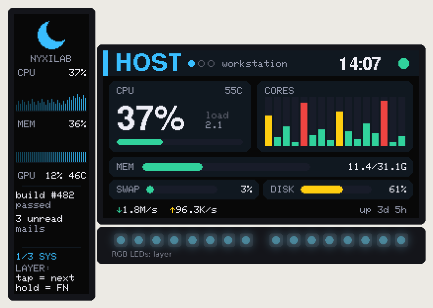
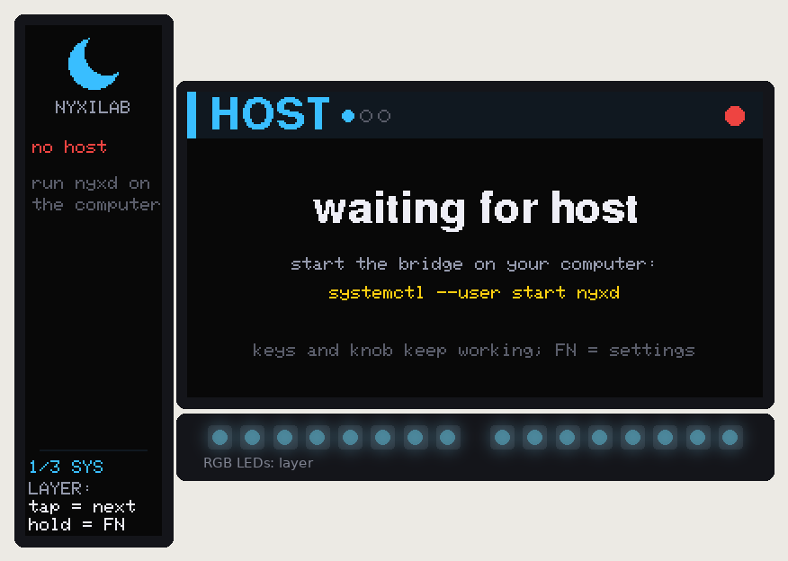
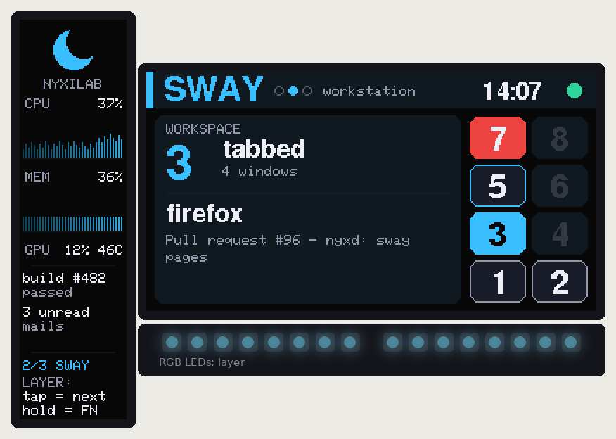
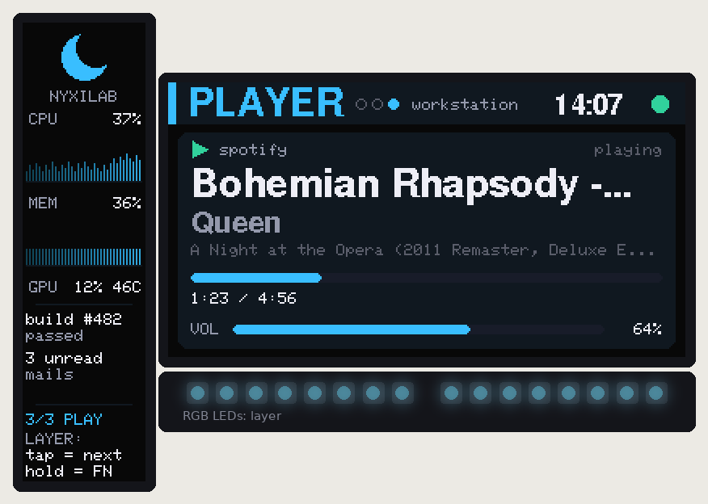

# Host bridge

An optional two-way link between the macropad and a daemon on your Linux
computer (`nyxd`, in [`host/`](../host)). With the daemon running, the **HOST
layer** turns both displays into a dashboard of the computer, on three pages:

1. **SYS**: CPU (total, per core, temperature, load), memory, swap, disk,
   network, uptime, GPU and the clock.
2. **SWAY**: sway's workspaces 1-8, and the focused workspace's layout, window
   count and focused window.
3. **PLAY**: the media player (MPRIS): track, artist, album, position, volume.

The bar display shows the system info and up to four lines of your own text on
every page. Keys on these pages send events back: the daemon switches sway
workspaces, controls the player, or runs your command.

Without the daemon nothing changes. The HOST layer stays out of the LAYER-key
cycle, and the macropad is the same keyboard as before.






## Set it up

1. **Flash** firmware with the host link: the current UF2 of your edition (`make firmware`).
   `HOST_LINK` in `include/config.h` turns it off.
2. **Install the daemon.** It is a Rust crate; [rustup](https://rustup.rs) provides `cargo`:
   ```bash
   cargo install --path host    # nyxd and nyxctl in ~/.cargo/bin (or: make host-install)
   ```
3. **Allow access.** This lets your user open the macropad's host interface (`/dev/hidrawN`) without root:
   ```bash
   sudo cp host/udev/70-nyxilab-macropad.rules /etc/udev/rules.d/
   sudo udevadm control --reload && sudo udevadm trigger
   ```
4. **Run it** as a user service:
   ```bash
   mkdir -p ~/.config/systemd/user && cp host/systemd/nyxd.service ~/.config/systemd/user/
   systemctl --user enable --now nyxd
   journalctl --user -u nyxd -f     # "connected: Nyxilab Macropad, rotary edition, 9 layers, protocol 1"
   ```
5. **Look at it.** Tap LAYER until HOST comes up (MEDIA → EDIT → F-keys → HOST).

`nyxd --probe` lists the macropads it can see and prints one metrics sample, sway's
state and the media player, without touching the device.

**For the SWAY page:** sway. `nyxd` talks to sway's IPC socket directly: `$SWAYSOCK`,
or else the newest `sway-ipc.<uid>.*.sock` in `$XDG_RUNTIME_DIR` (a systemd user
service does not get `SWAYSOCK` unless the sway config imports it). Without sway the
page says "sway not running" and its grid stays dim; the daemon looks for sway again
every 2 s.

**For the PLAY page:** [`playerctl`](https://github.com/altdesktop/playerctl) on `PATH`
(tested with 2.4.1). `nyxd` runs `playerctl --follow metadata` as a child and reads its
output; there is no D-Bus code in the daemon. Without `playerctl` (logged once) or
without a player, the page says "no media player". If `playerctl` exits, the daemon
starts it again after 2 s.

## Use it

| | |
|---|---|
| `nyxctl text 0 build passed` | show text in slot 0..3 on the bar display (2 lines × 12 characters per slot) |
| `nyxctl clear [slot]` | clear one slot, or all |
| `nyxctl status` | connected?, device, firmware, edition, is the dashboard on screen, current text, sway, the player |
| `~/.config/nyxd/config.toml` | update interval, disk, GPU source, **commands for the HOST keys**, start-up text ([example](../host/config.example.toml)) |

### The three pages and their keys

The three pages are one layer: LAYER skips the SWAY and PLAY pages, and tapping LAYER on
any page moves on to MEDIA. The left column is the same on every page; the right block
is numbered from the front row up (1 2 at the front, 7 8 at the back). The knob keeps
volume, the stick moves the mouse.

| key | SYS page | SWAY page | PLAY page |
|---|---|---|---|
| col 0, back | PLAY: go to the PLAY page | PLAY | PLAY |
| col 0 | SWAY: go to the SWAY page | SWAY | SWAY |
| col 0 | SYS: go to the SYS page | SYS | SYS |
| col 0, front | LAYER: tap = next layer, hold = FN | LAYER | LAYER |
| right block 1 … 8 | `HOST(1)` … `HOST(8)`, labels H1 … H8 | `HOST(201)` … `HOST(208)`, labels 1 … 8 | `HOST(211)` … `HOST(218)` |

What the daemon does with a key id:

| id | label | action |
|---|---|---|
| 1 … 8 | H1 … H8 | the command in `[keys]`; nothing (logged) without one |
| 201 … 208 | 1 … 8 | sway: `workspace number N` (logged if sway is not running) |
| 211 | PLAY | `playerctl play-pause` |
| 212 | NEXT | `playerctl next` |
| 213 | PREV | `playerctl previous` |
| 214 | STOP | `playerctl stop` |
| 215 | -10s | `playerctl position 10-` |
| 216 | +10s | `playerctl position 10+` |
| 217 | VOL- | `playerctl volume 0.05-` |
| 218 | VOL+ | `playerctl volume 0.05+` |

The player commands run as argv, never through a shell, with `--player <instance>`: they
go to the player the page shows, not to playerctl's default. With no player present a
player key is logged and nothing runs.

A `[keys]` entry for **any** id overrides the built-in action and runs that shell command
(through `/bin/sh`, as you, detached from `nyxd`):

```toml
[keys]
1 = "loginctl lock-session"
211 = "playerctl --player spotify play-pause"   # always spotify, not the player shown
```

`HOST(n)` works on any layer, and on the knob too:
`KNOB(HOST(20), HOST(21), HOST(22), "HOST")`. A layer shows a dashboard page with
`View::Host` (SYS), `View::Sway` or `View::Player` as its fifth field; a sixth field makes
it a further page of another layer (`View::Sway, L_HOST`). See the keymap of your edition.

### What the pages show

- **Header (main display, every page):** the page's layer name, three page dots (SYS,
  SWAY, PLAY; the current one filled), the host name, the host clock and the link dot.
- **SYS:** the system monitor.
- **SWAY:** on the right a 2 × 4 grid of workspaces laid out like the keys that switch to
  them (7 8 at the top, 1 2 at the bottom): focused = filled with the accent colour,
  urgent = red, visible on another monitor = accent outline, open = light outline, not
  open = dim. On the left the focused workspace number ("-" outside 1-8), its layout
  (splith, splitv, tabbed, stacked), the window count, the focused window's app_id and
  its title (at most 3 lines, cut with "..."); "no window" on an empty workspace.
- **PLAY:** a status icon (triangle playing, two bars paused, square stopped) with the
  player name and a status word, the title (large), artist and album (each cut to fit),
  a progress bar with `m:ss / m:ss` (`h:mm:ss` from an hour on; only the position when
  the length is unknown), and a volume bar when the player reports its volume.
- **Bar display (every page):** CPU and memory history, GPU and the text slots, and at
  the bottom a legend that the LAYER key still works: the page (`1/3 SYS`, `2/3 SWAY`,
  `3/3 PLAY`) and `LAYER:` / `tap = next` / `hold = FN`. Without a daemon it says
  "no host" and still shows the legend.
- **Not linked:** "waiting for host" on every page. Linked but no METRICS yet: "waiting
  for the first metrics" on the SYS page only; SWAY and PLAY draw at once.

## How it works

```
 computer                                         macropad (core 0)                    core 1
 ┌───────────────────────┐   USB, vendor HID     ┌─────────────────────────────┐      ┌──────────────┐
 │ nyxd                  │   64-byte reports     │ hw/host_hid  (ring, IRQ-safe)│      │ ui/render    │
 │  metrics (/proc, /sys)├──────────────────────►│ core/host_proto (parse, link)├─────►│  host view   │
 │  hidraw discovery     │◄──────────────────────┤ app: state, HOST(n) events   │ snap │  of the top  │
 │  control socket ◄─ nyxctl                     │ engine: HOST action, skip    │ shot │  layer       │
 └───────────────────────┘                       └─────────────────────────────┘      └──────────────┘
```

- **Transport: a second HID interface.** It has a vendor usage page (0xFF4E, usage
  0x58), 64-byte input and output reports, and its own endpoints. Linux gives it a
  `/dev/hidrawN` with no driver. It is separate from the keyboard interface, so host
  traffic never delays a keystroke. Its interface string, "Nyxilab Host Link",
  lets the udev rule match it and not the keyboard.
- **Firmware.** Each part has one job:
  - `core/host_proto` is pure C++ and unit-tested: it parses packets, keeps the
    data and history, and runs the link timeout and the send queue.
  - `hw/host_hid` owns the USB interface.
  - `nyx_app` connects them: it reads packets, reports state, sends `HOST(n)`
    events, and hides HOST layers from the LAYER cycle while no daemon is connected.
  - The renderer draws the host views (`View::Host`, `View::Sway`, `View::Player`)
    from the UI snapshot, like everything else.
- **Daemon** (Rust, `host/src`). One thread runs `poll(2)` over the hidraw node, the
  control socket, sway's IPC socket (subscribed to workspace and window events, then
  GET_WORKSPACES + GET_TREE), the stdout of a `playerctl --follow` child, and timers. It
  sends metrics every second, reconnects after unplugging or a macropad reset (and to sway
  and playerctl when they come back), and sends `BYE` when stopped.

### Why not …

| option | why not |
|---|---|
| the USB serial port (CDC) | already the console; ModemManager probes `ttyACM` devices; needs `dialout`; text and binary would share one stream |
| a report id on the keyboard interface | shares the keyboard's endpoint and timing; Windows and macOS keep keyboard interfaces away from applications |
| a custom kernel driver / vendor class | hidraw already does it, on every distribution, without root (udev `uaccess`) |
| QMK's raw-HID usage page (0xFF60) | VIA and other QMK tools would try to talk to the macropad |

## Protocol (version 1)

Every packet in both directions is 64 bytes: `[0]` type, `[1]` protocol version,
`[2..63]` payload, little-endian. Packets with another version are ignored. The
source of truth is [`host_proto.h`](../common/firmware/lib/nyx_core/src/core/host_proto.h);
`host/src/protocol.rs` must match it. `host/tests/interop.rs` runs the
firmware's parser against the daemon's encoder.

**Host → device**

| type | payload |
|---|---|
| `0x01` HELLO | `[2..32]` hostname, ASCII, NUL-padded. Starts a session: the device clears old data and answers HELLO_ACK |
| `0x02` METRICS | see below. Sent every `interval` (1 s); it is also the keep-alive |
| `0x03` TEXT | `[2]` slot 0..3, `[3..62]` text, printable ASCII, NUL-padded; empty = clear |
| `0x04` BYE | the daemon is stopping: the device shows "waiting for host" at once |
| `0x05` WORKSPACES | sway's state, see below. Sent on change |
| `0x06` PLAYER | the media player, see below. Sent on change, and every `interval` while playing (the position advances) |
| `0x07` PLAYER_TEXT | `[2]` field: 0 title, 1 artist, 2 album (3 or more: the packet is rejected), `[3..62]` text |

METRICS (`0xFF` = unknown percentage or clock field, `-32768` = unknown temperature):

| bytes | field | | bytes | field |
|---|---|---|---|---|
| 2 | CPU % | | 32..33 | load average (1 min) × 100 |
| 3 | number of core bars (≤ 16; more cores are averaged in groups) | | 34..37 | network receive, bytes/s |
| 4..19 | per-core % | | 38..41 | network send, bytes/s |
| 20..23 | memory used, MiB (total − available) | | 42..45 | uptime, s |
| 24..27 | memory total, MiB | | 46 | GPU % |
| 28 | swap % | | 47..48 | GPU temperature, 0.1 °C |
| 29 | disk % (as `df` shows it) | | 49, 50 | host clock, hour and minute |
| 30..31 | CPU temperature, 0.1 °C | | | |

Strings in every packet are printable ASCII (0x20..0x7E), NUL-padded. The daemon
transliterates (accents stripped, anything else becomes `?`); the firmware replaces any
other byte with `?`. In a mask, bit n−1 is workspace n.

WORKSPACES (`[2]` = 0: sway is not running, the rest is ignored and the device clears its sway state):

| bytes | field |
|---|---|
| 2 | 1 = sway running |
| 3 | focused workspace 1..8; 0 = a workspace outside 1..8, or none (the firmware maps > 8 to 0) |
| 4 | open mask (workspaces that exist) |
| 5 | visible mask (shown on a monitor) |
| 6 | urgent mask |
| 7 | windows on the focused workspace, tiling + floating (saturates at 255) |
| 8 | layout of the focused workspace: 0 unknown, 1 splith, 2 splitv, 3 tabbed, 4 stacked (> 4 = unknown) |
| 9..20 | focused window's app_id, 12 characters (XWayland windows: `window_properties.class`) |
| 21..60 | focused window's title, 40 characters |

The two strings are empty when an empty workspace has the focus.

PLAYER (`[2]` = 0: no media player, the rest is ignored and the device clears its player state, track text included):

| bytes | field |
|---|---|
| 2 | 1 = a media player is present |
| 3 | status: 0 stopped, 1 playing, 2 paused (> 2 = stopped) |
| 4 | player volume 0..100 %, 255 = unknown (101..254 = unknown) |
| 5..6 | position, s (u16; the daemon saturates at 65535) |
| 7..8 | track length, s (u16); 0 = unknown (the daemon sends 0 for a length above 65535 s, e.g. a live stream) |
| 9..24 | player name, 16 characters (e.g. `spotify`) |

The device stores PLAYER_TEXT even while no player is present, and a PLAYER with
`[2]` = 0 clears it, so the daemon sends PLAYER before the three PLAYER_TEXT packets.

**Device → host**

| type | payload |
|---|---|
| `0x81` HELLO_ACK | `[2]` edition (1 joystick, 2 rotary), `[3]` layers, `[4]` protocol version, `[5..]` firmware name |
| `0x82` KEY | `[2]` id of the `HOST(id)` action, `[3]` 1 pressed / 0 released |
| `0x83` STATE | `[2]` dashboard on screen (any host page), `[3]` base layer, `[4]` top layer. Sent after HELLO and on change |

**Link rules**

- **A HELLO starts a session.** The device clears all host data (metrics, text, sway,
  player). The daemon then sends its text, WORKSPACES, PLAYER and all three PLAYER_TEXT
  fields, even when sway or a player is absent. BYE and the link timeout clear the same
  data.
- **Unknown packets are ignored.** The firmware drops packet types it does not know.
- **Connected while packets arrive.** The device treats the host as connected
  while a packet arrives at least every 5 s; otherwise it drops the data and shows
  "waiting for host".
- **Recovery after a timeout.** If packets start arriving again without a HELLO (for
  example after the computer slept), the device sends an unrequested HELLO_ACK. The
  daemon answers with HELLO and its text again.
- **Queue limits.** The device queues at most 8 outgoing packets and only while
  connected. Its receive ring holds 15, enough for a whole session start. METRICS (and PLAYER while playing) repeat every
  second, so a dropped one costs a second. WORKSPACES, TEXT and PLAYER_TEXT are sent only
  on a change or after a HELLO: a dropped one stays wrong until the next change.

## Testing without the hardware

| what | how |
|---|---|
| protocol (WORKSPACES, PLAYER, PLAYER_TEXT included), link timeout, queues, `HOST` action, LAYER-cycle skipping | `make test-core` (Unity, `common/firmware/test/test_core`) |
| the USB interface code (ring buffer, busy endpoint, suspended host); the three HOST pages' keys and links; the dashboard's text formats | `make test-hardware` (mocked TinyUSB) |
| both screens on every page | `make ui-sim` → `docs/images/<edition>/ui/ui_06_*`, `ui_07_*`, `ui_09_*` … `ui_13_*` |
| daemon: metrics, discovery, reconnects, key commands, nyxctl, sway against a fake sway socket, the player against a fake `playerctl`, firmware ↔ daemon bytes; clippy, rustfmt | `make test-host` (`cargo test`) |
| the C++ tests again under AddressSanitizer + UndefinedBehaviorSanitizer | `make test-sanitize` |

On a real machine, `nyxd -v` logs every connection and state change, and the
macropad's `info` console command prints `host linked <hostname>`.

## Limits and next steps

- **Linux only.** Windows and macOS can open the same vendor interface: hidapi
  works there and needs no driver. A port is mostly `src/device.rs` and `src/metrics.rs`.
- **Not tested on real hardware.** This bridge was built and verified without a
  macropad: unit tests, mocks, the UI simulator and the cross-language test. The
  first flash should check the following:
  - `nyxd --probe` finds the macropad.
  - The dashboard updates every second.
  - A `HOST` key runs its command.
- **Fixed pages.** The three pages' layouts are fixed in the firmware. A future
  protocol version could let the daemon define its own fields.
- **Sway only.** The SWAY page speaks sway's IPC; i3 and other window managers are not
  read. Workspaces above 8 have no cell (the focused number shows "-").
- **One daemon per macropad.** Two `nyxd` instances would fight over the device. The
  control socket refuses a second instance for the same user.
