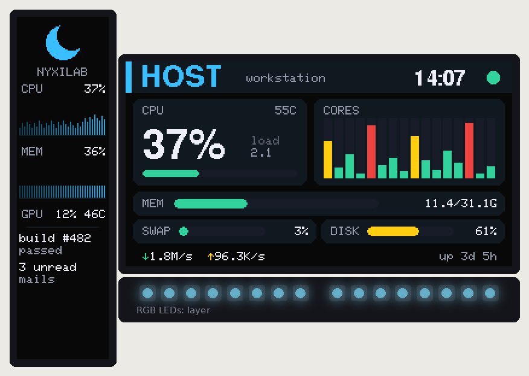
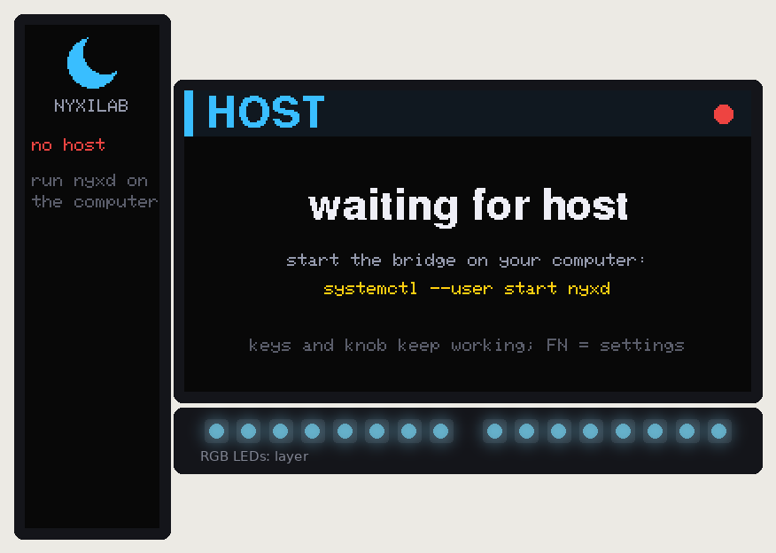

# Host bridge

An optional two-way link between the macropad and a daemon on your Linux
computer (`nyxd`, in [`host/`](../host)). With the daemon running, the **HOST
layer** turns both displays into a dashboard of the computer: CPU (total, per
core, temperature, load), memory, swap, disk, network, uptime, GPU, the clock,
and up to four lines of your own text. Keys on that layer send events back, and
the daemon runs a command for each one.

Without the daemon nothing changes. The HOST layer stays out of the LAYER-key
cycle, and the macropad is the same keyboard as before.




## Set it up

1. **Flash** firmware with the host link: the current UF2 of your edition (`make firmware`).
   `HOST_LINK` in `include/config.h` turns it off.
2. **Install the daemon.** It needs only Python 3.9+, plus `tomli` for a config file on Python < 3.11:
   ```bash
   pipx install ./host          # or: pip install --user ./host
   ```
3. **Allow access.** This lets your user open the macropad's host interface (`/dev/hidrawN`) without root:
   ```bash
   sudo cp host/udev/70-nyxilab-macropad.rules /etc/udev/rules.d/
   sudo udevadm control --reload && sudo udevadm trigger
   ```
4. **Run it** as a user service:
   ```bash
   mkdir -p ~/.config/systemd/user && cp host/systemd/nyxd.service ~/.config/systemd/user/
   systemctl --user enable --now nyxd
   journalctl --user -u nyxd -f     # "connected: Nyxilab Macropad, rotary edition, 5 layers"
   ```
5. **Look at it.** Tap LAYER until HOST comes up (MEDIA → EDIT → F13-24 → HOST).

`nyxd --probe` lists the macropads it can see and prints one metrics sample,
without touching the device.

## Use it

| | |
|---|---|
| `nyxctl text 0 build passed` | show text in slot 0..3 on the bar display (2 lines × 12 characters per slot) |
| `nyxctl clear [slot]` | clear one slot, or all |
| `nyxctl status` | connected?, device, firmware, edition, is the dashboard on screen, current text |
| `~/.config/nyxd/config.toml` | update interval, disk, GPU source, **commands for the HOST keys**, start-up text ([example](../host/config.example.toml)) |

The HOST layer's keys are `HOST(1)` … `HOST(11)` (labels H1 … H11, shown while FN
is held). The knob keeps volume, the stick moves the mouse. Map keys in the config:

```toml
[keys]
1 = "playerctl play-pause"
2 = "loginctl lock-session"
```

`HOST(n)` works on any layer, and on the knob too:
`KNOB(HOST(20), HOST(21), HOST(22), "HOST")`. Any layer becomes a dashboard
with `View::Host` as its last field. See the keymap of your edition.

## How it works

```
 computer                                         macropad (core 0)                    core 1
 ┌───────────────────────┐   USB, vendor HID     ┌─────────────────────────────┐      ┌──────────────┐
 │ nyxd                  │   64-byte reports     │ hw/host_hid  (ring, IRQ-safe)│      │ ui/render    │
 │  metrics (/proc, /sys)├──────────────────────►│ core/host_proto (parse, link)├─────►│  host view   │
 │  hidraw discovery     │◄──────────────────────┤ app: state, HOST(n) events   │ snap │  of the top  │
 │  control socket ◄─ nyxctl                     │ engine: HOST action, skip    │ shot │  layer       │
 └───────────────────────┘                       └─────────────────────────────┘      └──────────────┘
```

- **Transport: a second HID interface.** It has a vendor usage page (0xFF4E, usage
  0x58), 64-byte input and output reports, and its own endpoints. Linux gives it a
  `/dev/hidrawN` with no driver. It is separate from the keyboard interface, so host
  traffic never delays a keystroke. Its interface string, "Nyxilab Host Link",
  lets the udev rule match it and not the keyboard.
- **Firmware.** Each part has one job:
  - `core/host_proto` is pure C++ and unit-tested: it parses packets, keeps the
    data and history, and runs the link timeout and the send queue.
  - `hw/host_hid` owns the USB interface.
  - `nyx_app` connects them: it reads packets, reports state, sends `HOST(n)`
    events, and hides HOST layers from the LAYER cycle while no daemon is connected.
  - The renderer draws `View::Host` layers from the UI snapshot, like everything else.
- **Daemon.** One thread runs a selector over the hidraw node, the control socket
  and two timers. It sends metrics every second, reconnects after unplugging or a
  macropad reset, and sends `BYE` when stopped.

### Why not …

| option | why not |
|---|---|
| the USB serial port (CDC) | already the console; ModemManager probes `ttyACM` devices; needs `dialout`; text and binary would share one stream |
| a report id on the keyboard interface | shares the keyboard's endpoint and timing; Windows and macOS keep keyboard interfaces away from applications |
| a custom kernel driver / vendor class | hidraw already does it, on every distribution, without root (udev `uaccess`) |
| QMK's raw-HID usage page (0xFF60) | VIA and other QMK tools would try to talk to the macropad |

## Protocol (version 1)

Every packet in both directions is 64 bytes: `[0]` type, `[1]` protocol version,
`[2..63]` payload, little-endian. Packets with another version are ignored. The
source of truth is [`host_proto.h`](../common/firmware/lib/nyx_core/src/core/host_proto.h);
`host/nyxd/protocol.py` must match it. `host/tests/test_interop.py` runs the
firmware's parser against the daemon's encoder.

**Host → device**

| type | payload |
|---|---|
| `0x01` HELLO | `[2..32]` hostname, ASCII, NUL-padded. Starts a session: the device clears old data and answers HELLO_ACK |
| `0x02` METRICS | see below. Sent every `interval` (1 s); it is also the keep-alive |
| `0x03` TEXT | `[2]` slot 0..3, `[3..62]` text, printable ASCII, NUL-padded; empty = clear |
| `0x04` BYE | the daemon is stopping: the device shows "waiting for host" at once |

METRICS (`0xFF` = unknown percentage or clock field, `-32768` = unknown temperature):

| bytes | field | | bytes | field |
|---|---|---|---|---|
| 2 | CPU % | | 32..33 | load average (1 min) × 100 |
| 3 | number of core bars (≤ 16; more cores are averaged in groups) | | 34..37 | network receive, bytes/s |
| 4..19 | per-core % | | 38..41 | network send, bytes/s |
| 20..23 | memory used, MiB (total − available) | | 42..45 | uptime, s |
| 24..27 | memory total, MiB | | 46 | GPU % |
| 28 | swap % | | 47..48 | GPU temperature, 0.1 °C |
| 29 | disk % (as `df` shows it) | | 49, 50 | host clock, hour and minute |
| 30..31 | CPU temperature, 0.1 °C | | | |

**Device → host**

| type | payload |
|---|---|
| `0x81` HELLO_ACK | `[2]` edition (1 joystick, 2 rotary), `[3]` layers, `[4]` protocol version, `[5..]` firmware name |
| `0x82` KEY | `[2]` id of the `HOST(id)` action, `[3]` 1 pressed / 0 released |
| `0x83` STATE | `[2]` dashboard on screen, `[3]` base layer, `[4]` top layer. Sent after HELLO and on change |

**Link rules**

- **Connected while packets arrive.** The device treats the host as connected
  while a packet arrives at least every 5 s; otherwise it drops the data and shows
  "waiting for host".
- **Recovery after a timeout.** If packets start arriving again without a HELLO (for
  example after the computer slept), the device sends an unrequested HELLO_ACK. The
  daemon answers with HELLO and its text again.
- **Queue limits.** The device queues at most 8 outgoing packets and only while
  connected. Its receive ring holds 3. The daemon re-sends everything that matters
  every second, so a dropped packet costs nothing.

## Testing without the hardware

| what | how |
|---|---|
| protocol, link timeout, queues, `HOST` action, LAYER-cycle skipping | `make test-core` (Unity, `common/firmware/test/test_core`) |
| the USB interface code (ring buffer, busy endpoint, suspended host) | `make test-hardware` (mocked TinyUSB) |
| both screens in host view | `make ui-sim` → `docs/images/<edition>/ui/ui_06_*`, `ui_07_*` |
| daemon: metrics, discovery, reconnects, key commands, nyxctl, firmware ↔ daemon bytes | `make test-host` |

On a real machine, `nyxd -v` logs every connection and state change, and the
macropad's `info` console command prints `host linked <hostname>`.

## Limits and next steps

- **Linux only.** Windows and macOS can open the same vendor interface: hidapi
  works there and needs no driver. A port is mostly `device.py` and `metrics.py`.
- **Not tested on real hardware.** This bridge was built and verified without a
  macropad: unit tests, mocks, the UI simulator and the cross-language test. The
  first flash should check the following:
  - `nyxd --probe` finds the macropad.
  - The dashboard updates every second.
  - A `HOST` key runs its command.
- **One-way display content.** The dashboard layout is fixed in the firmware. A
  future protocol version could add pages (the knob could switch them) or let the
  daemon define its own fields.
- **One daemon per macropad.** Two `nyxd` instances would fight over the device. The
  control socket refuses a second instance for the same user.
