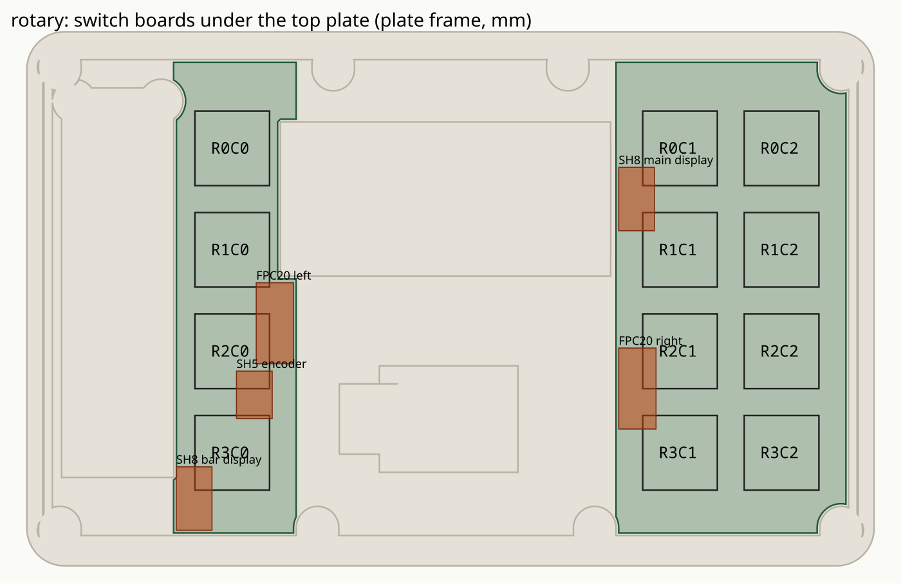
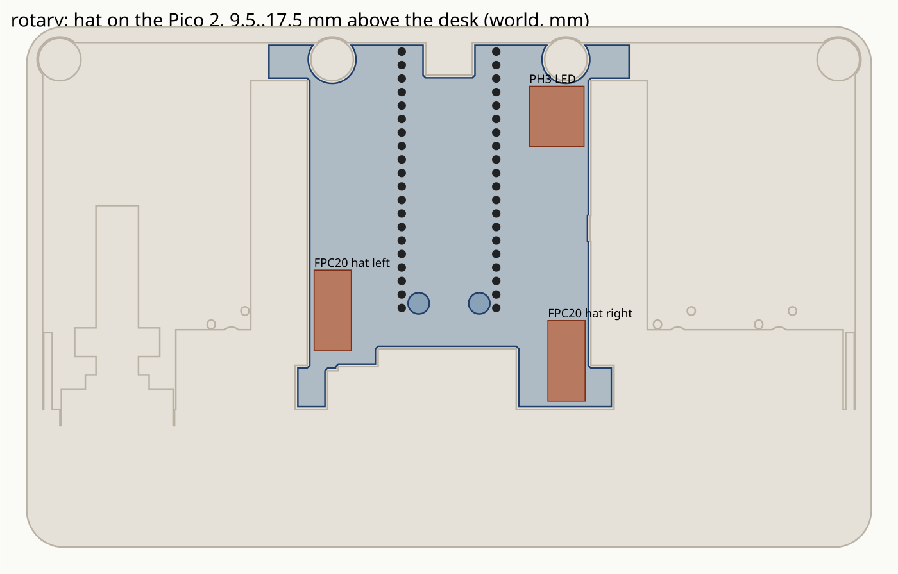
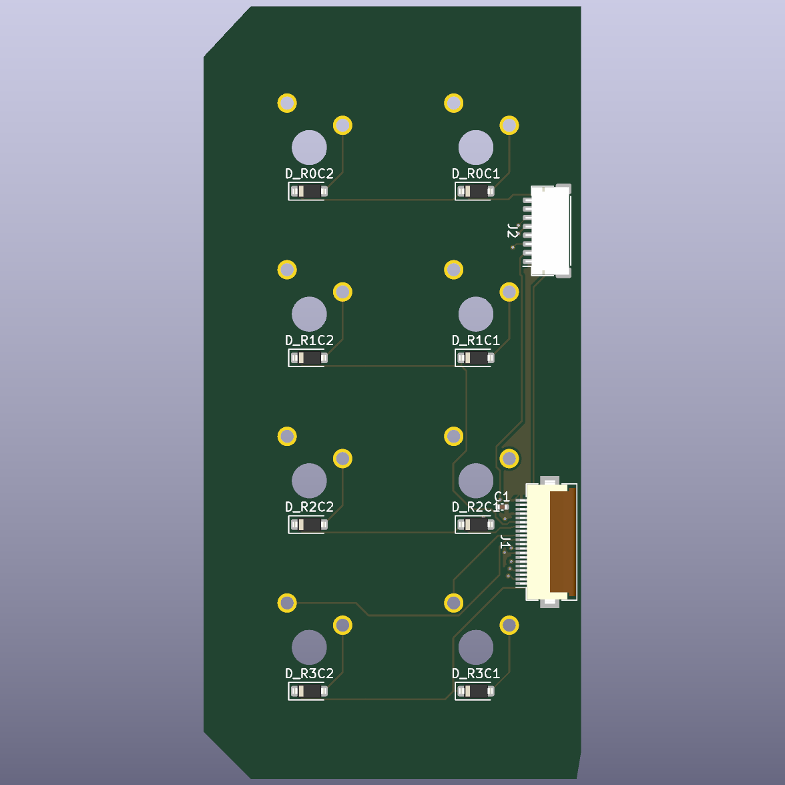
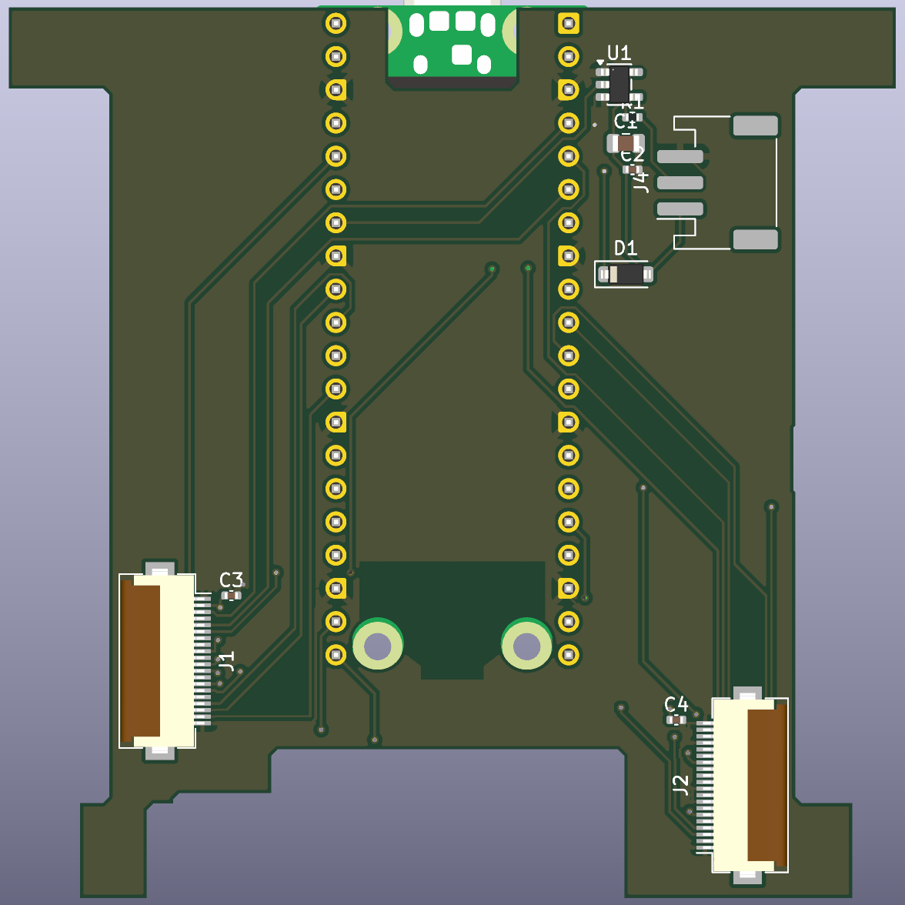

# PCB build

The same macropad without the wire nest: three printed circuit boards and two flat cables replace
every hand-soldered wire inside the case. The case, the modules and the firmware stay the same;
the Pico 2 stays where it is, so its USB-C port still meets the opening in the back wall.

This page says what to order where, what to print, what to prepare on the bench and how to put it
together. The hand-wired build is still [the build guide](build-guide.md); the two share the printed
case and most of the hardware.

> [!WARNING]
> The boards are generated and checked, but none has been ordered or built yet. Read
> [before you order](#7-before-you-order) first: two parts need a stock check, and the dimensions
> the CAD marks as measured from photos are worth measuring on your parts.

## 1. What gets made

| Board | Size | On it | Same for both editions |
|---|---|---|---|
| **left** | 23 × 88 mm | the 4 switches of the left column with their diodes; plugs for the bar display and the encoder | yes (the encoder plug stays empty on the joystick edition) |
| **right** | 43 × 88 mm | the 8 switches of the right block with their diodes; plug for the main display | yes |
| **hat** | 68 × 68 mm | sits on the Pico 2's two pin rows; both flat-cable sockets, the LED plug and its level shifter | no: `hat-rotary` or `hat-joystick` (the joystick's dome cuts the hat's front) |

| Top plate side (switch boards) | Base side (hat) |
|---|---|
|  |  |

Green and blue: the boards. Grey: everything of the case at their height. Orange: the connectors.

| right board, from below | hat, from above |
|---|---|
|  |  |

**How it connects**

| From | To | By |
|---|---|---|
| left board | hat | 20-pin flat cable (rows, column 0, bar display, encoder, 3V3, GND) |
| right board | hat | 20-pin flat cable (rows, columns 1-2, main display, 3V3, GND) |
| main display | right board | 8-wire JST-SH pigtail soldered into the display's header holes |
| bar display | left board | 8-wire JST-SH pigtail soldered into the display's header holes |
| encoder (rotary) | left board | its own header, a 2.54 mm female header with a 5-wire JST-SH pigtail |
| joystick (joystick) | hat | the same, plugged into the hat's front |
| hat | right LED stick | 3-wire JST-PH cable, then 3 short wires on to the left stick |

To open the case you unplug the two flat cables; nothing else crosses from the plate to the base.
Every pin, net and cable pinout is in [pcb/pinout.md](../pcb/pinout.md). The firmware does not change:
the boards route the same GPIOs as the hand wiring ([wiring](wiring.md)).

## 2. Order the boards: PCBWay turnkey PCBA

PCBWay makes the boards and buys and solders every part on them from its distributors (Digi-Key,
Mouser, Arrow, Avnet and others). You order two switch boards and the hat of your edition.

**Files**, per board in [pcb/fab](../pcb/fab) (rebuild with `make pcb-fab`):

| File | For |
|---|---|
| `<board>-gerbers.zip` | the board: copper, solder mask, paste, silkscreen, outline, drill (PTH and NPTH) |
| `<board>-bom.csv` | the bill of materials, with part numbers, and what not to fit |
| `<board>-pos.csv` | pick-and-place, both sides, in mm |

**Board options**

| Option | Value |
|---|---|
| Layers | 2 |
| Material, thickness | FR-4, 1.6 mm |
| Copper | 1 oz |
| Minimum track / spacing | 0.15 mm / 0.2 mm (6 / 8 mil) |
| Minimum drill | 0.3 mm (vias 0.3 / 0.6 mm) |
| Copper to board edge | 0.25 mm; the Pico's pins 1 and 40 sit 0.41 mm from the hat's back edge |
| Surface finish | ENIG: flat pads for the 0.5 mm pitch FPC sockets |
| Assembly | switch boards: SMT on the **bottom** side only. Hat: SMT on the top side, plus one through-hole part |

**What PCBWay fits** (from the BOM files)

| Part | Part number | left | right | hat-rotary | hat-joystick |
|---|---|---|---|---|---|
| FPC socket, 20 pins, 0.5 mm, bottom contact | Hirose FH12-20S-0.5SH(55) | 1 | 1 | 2 | 2 |
| JST-SH header, 8 pins, side entry | JST SM08B-SRSS-TB(LF)(SN) | 1 | 1 | | |
| JST-SH header, 5 pins, side entry | JST SM05B-SRSS-TB(LF)(SN) | 1 (rotary only) | | | 1 |
| JST-PH header, 3 pins, side entry, SMD | JST S3B-PH-SM4-TB(LF)(SN) | | | 1 | 1 |
| Buffer, 5 V TTL-level inputs, SOT-23-5 | TI SN74AHCT1G125DBVR | | | 1 | 1 |
| Switching diode, SOD-123 | 1N4148W | 4 | 8 | | |
| Schottky diode 40 V 1 A, SOD-123 | B5819W | | | 1 | 1 |
| Capacitor 100 nF X7R 0402 | generic | 1 | 1 | 3 | 3 |
| Capacitor 10 µF X5R 0805 | generic | | | 1 | 1 |
| Resistor 330 Ω 1 % 0402 | generic | | | 1 | 1 |
| Pin header 1 × 20, 2.54 mm, straight (×2) | generic | | | 1 set | 1 set |

Three notes for the order form:

1. **The switches are not fitted.** They are in the BOM as "do not assemble": you put your own
   switches through the top plate and solder them (section 5).
2. **The Pico 2 is not fitted either.** The official Pico 2 (SC1631) has micro-USB and no
   distributor sells the USB-C board the case is made for. PCBWay fits the two pin headers into the
   hat, **plastic on the bottom side, long pins pointing down**; you solder your Pico onto them.
   If you would rather fit the headers yourself, mark H1 "do not assemble" too.
3. **One left board per edition.** On the joystick edition leave J3 (the encoder plug) out, or fit
   it anyway; it does no harm.

Ask for the quote with the files and these notes. PCBWay's pages state no minimum quantity in one
place and 5 pieces in another: the quote form settles it.

## 3. Buy separately

These are not on the boards, so no assembler buys them. All are catalogue parts (Digi-Key, Mouser, LCSC).

| Qty | Part | For | Example |
|---|---|---|---|
| 2 | Flat cable (FFC), 20 conductors, 0.5 mm pitch, ~50 mm, **contacts on opposite sides** (type B) | switch boards to hat | Molex Premo-Flex, 20 circuits, 50.8 mm, opposite-side; check the termination field of the listing |
| 1 | JST-SH 8-pin cable, socket both ends, 50 mm | cut in half: the two display pigtails | JST A08SR08SR30K51B |
| 1 | JST-SH 5-pin cable, socket both ends, 50 mm | cut in half: the encoder or joystick pigtail (one spare) | JST A05SR05SR30K51B (same family; check the listing) |
| 1 | JST-PH 3-pin cable with one bare end, ~50 mm | hat to the right LED stick | any pre-crimped JST-PH 2.0 mm 3-pin pigtail |
| 1 | 2.54 mm female header, 1 × 5 | onto the encoder's or joystick's own right-angle header | generic |
| – | ~20 cm of 28 AWG wire in three colours | right LED stick to left stick (5V, data, GND) | |
| – | heat-shrink, 2-3 mm | the pigtail joints | |

**Why type B (opposite sides):** the socket on a switch board hangs upside down under the board, so
its contacts face up; the hat's socket faces up, so its contacts face down. The cable drops from one
to the other without turning over, so its bare ends must face opposite ways. Pin 1 reaches pin 1 on
both cables in both editions (checked on the placed footprints). If you swap the FH12 sockets for the
top-contact FH12A at both ends it stays type B; with one of each it becomes type A.

## 4. What you keep, change and no longer need

From the [bill of materials](assembly.md#bill-of-materials) of the hand-wired build:

| Keep | Change | No longer needed |
|---|---|---|
| Pico 2 (USB-C), 12 MX switches, 12 keycaps | **Pico screws: 2 × M2 × 5 button head, ISO 7380** (3.5 mm head, 1.3 mm hex key). They go through 4.0 mm holes in the hat; a pan head (4.0 mm) does not fit through | 12 × 1N4148 through-hole diodes (on the boards now) |
| both displays, both LED sticks, the encoder or joystick | **Switches: plate-mount, 3 pins.** The boards have holes for the two pins and the centre post only; clip the two plastic legs of 5-pin switches | 1N4001 and the 330 Ω resistor (on the hat now) |
| 8 heat-set inserts, 8 × M3 × 8, display screws (4 × M2 × 4, 2 × M2 × 8), 4 × M2 × 5 for the LED sticks, 4 feet | | ~2.5 m of wire, Kapton tape, cable ties |
| joystick edition: 4 × M3 × 6 for its posts | | |

## 5. Print

Print the case as in [printing](printing.md): top plate, frame, base, bar spine, and the knob on the
rotary edition. Two differences:

- **Ballast:** print `pcb/<edition>/ballast_pcb.stl`, not the one in the case exports. It is cut
  around the hat, its cables and the LED cable, and still drops in from above (84 g joystick,
  87 g rotary as solid PLA, 100 % infill). The STL is in the case's coordinates, so let the slicer
  drop it onto the bed; it prints flat side down without supports.
- **Fit test:** print `fit_switch` from the fit-test coupons as usual: the switches still clip into
  the printed plate, the boards only hang on their pins.

## 6. Build

### 6.1 On the bench, before anything goes into the case

1. **Display pigtails.** Cut the 8-pin JST-SH cable in the middle. Solder the bare ends of one half
   into the main display's 8 header holes, the other half into the bar display's: **pin 1 of the
   plug (the marked wire) to the module's GND**, then in the order of the module's header (GND, VCC,
   SCL, SDA, RES, DC, CS, BL). Do not fit a pin header on the displays. The bar display's pigtail
   leaves towards its front end: the bar spine clamps the module right behind the header.
2. **Encoder or joystick plug.** Cut the 5-pin cable in the middle. Solder one half's bare ends to
   the tails of the 1 × 5 female header, in the module's header order: KY-040 CLK, DT, SW, +, GND;
   KY-023 GND, +5V, VRx, VRy, SW. Heat-shrink each joint.
3. **LED sticks.** Solder the JST-PH pigtail to the right stick's DIN end (5V, DIN, GND), and 3
   wires from its DOUT end to the left stick's DIN end. The hat makes the 5 V data level and limits
   the current; no diode or resistor in the wires.
4. **Pico on the hat.** With the hat's headers fitted (by PCBWay or by you, plastic under the hat),
   put the Pico under it, component side up, USB-C at the hat's back edge, and solder the 40 pins
   on the Pico's underside. Trim them to 1 mm: the Pico's underside sits on the base's standoffs.

**Test:** flash the firmware over USB-C ([flashing](build-guide.md#5-flash-the-firmware)) and
plug the displays into a switch board on the bench to see the UI come up through the flat cables.
BOOTSEL is under the hat; you do not need it (the boot-key combo and `pio run -t upload` reboot
into the bootloader).

### 6.2 Top plate

1. Press the 8 heat-set inserts into the plate and stick the feet under the base
   ([assembly, step 1](assembly.md#1--prepare-the-printed-parts)).
2. Clip the 12 switches into the plate. Screw both displays into their pockets; rotary edition: the
   encoder with its washer and M7 nut ([assembly, step 2](assembly.md#2--build-the-top-plate)).
3. Lower the **left** and **right** boards onto the switch pins from below (their parts face down,
   away from the plate) and solder the 24 joints.
4. Plug the display pigtails into the boards (J2 on each). Rotary edition: push the female header
   onto the encoder's pins and plug its pigtail into J3 on the left board.
5. Open the flip-lock of J1 on both boards, slide in a flat cable (bare contacts towards the
   board), close the lock.

**Test:** every switch sits flush. With a continuity tester on the free end of each flat cable, every
switch joins its column pin to its row pin while pressed ([pinout](../pcb/pinout.md)).

### 6.3 Base

1. Screw the LED sticks onto their posts (4 × M2 × 5). Joystick edition: the joystick onto its
   posts (4 × M3 × 6), its plug on its header.
2. Lower the Pico with the hat: tilt it, push the USB-C receptacle into the opening in the back
   wall, set the far end on the two standoffs, and drive the **2 × M2 × 5 button-head** screws
   through the hat's two holes into the standoffs.
3. Plug the LED pigtail into J4 on the hat; joystick edition: its pigtail into J3 at the hat's front.
4. Drop in the PCB ballast.

### 6.4 Close

1. Hold the plate just above the base, open the flip-locks of J1 and J2 on the hat and slide the
   flat cables in: the left board's into J1 (the hat's left), the right board's into J2. Close the locks.
2. Lower the plate onto the frame, folding the cable slack under the boards.
3. Turn the pad over and drive the 8 × M3 × 8 screws, evenly ([assembly, step 6](assembly.md#6--close-the-case)).

**Test:** the green boot sequence runs on the LEDs; both screens show the MEDIA layer; every key
and the knob or stick work ([firmware](../common/firmware/README.md)).

## 7. Before you order

| Check | Why |
|---|---|
| Live stock of **Hirose FH12-20S-0.5SH(55)** and **JST S3B-PH-SM4-TB** in small quantities | the searches found distributor stock only with 1,000-2,000 piece minimums or no stock figure |
| A **B5819W** maker in stock | one common listing (MDD) showed none left; any 40 V 1 A SOD-123 Schottky fits |
| The FFC's **termination** field says opposite sides | section 3 |
| Measure the parts the CAD marks `MEASURE` ([params.py](../common/cad/macropad_cad/params.py)) | the Pico clone, the display holes, the encoder header and the LED sticks are from photos |
| Print the 1:1 top-plate template and hold the boards' outlines against it | `<edition>/cad/exports/drawings/` |
| PCBWay accepts 0.25 mm copper to the board edge | the hat's back edge |
| Review the autorouted tracks in KiCad around the FPC sockets | they route and pass DRC, but nobody has looked at them with a soldering iron in mind |

## 8. How it is made, and how to rebuild it

All of it comes from the case model and the firmware's `config.h`, so a change to either flows through:

| Command | Does |
|---|---|
| `make pcb` | `tools/pcb_layout.py`: cuts the outlines from the case model, places the connectors, pigtails and cable routes, checks them against the case and each other (690 / 710 pairs), cuts the ballast. `tools/pcb_nets.py`: nets and pinouts, checked against both editions' `config.h` |
| `make pcb-kicad` | `tools/pcb_kicad.py`: the four KiCad boards, routed by Freerouting, then KiCad's design-rule check (needs KiCad 10 and the `freerouting` wrapper around the 2.5.0 jar) |
| `make pcb-fab` | `tools/pcb_fab.py`: the order files in `pcb/fab/` and the pictures on this page |

The boards open in KiCad: `pcb/kicad/<board>/<board>.kicad_pcb`.
